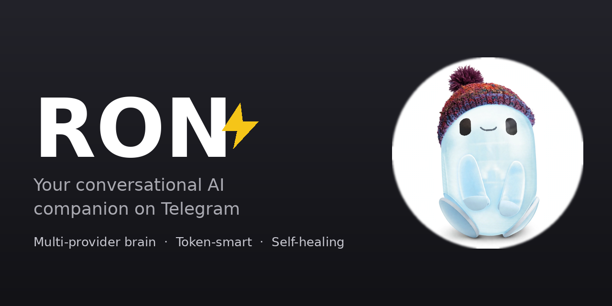

<div align="center">

# 🤖 Ron

**Your conversational AI companion on Telegram**

*A self-sufficient AI companion on Telegram — multi-provider brain, token-smart, and self-healing.*

[](https://t.me/ronrebootedbot)
[](https://www.python.org/)
[]()
[](LICENSE)
[]()

💬 **Try it:** [@ronrebootedbot](https://t.me/ronrebootedbot)

</div>

---

## ✨ What is Ron?

Ron is a **full-featured conversational Telegram AI bot** that feels less like a script and more like a sharp friend who happens to live in your chats. It answers DMs from anyone, politely stays quiet in groups until mentioned, streams long answers as you watch, and doubles as a group-management power tool with native polls, quizzes, and forum-topic controls.

## 🚀 At a glance

| | | |
|---|---|---|
| 📷 **Image reading** — understands photos you send | 🎨 **Image generation** — `/imagine` anything | 💬 **Multi-provider brain** — Groq → Gemini → OpenRouter → Pollinations failover |
| 🪙 **Token-smart** — cheap routing, caching, summaries | 🧠 **Private memory** — encrypted, per-chat, isolated | 🩺 **Self-healing** — watchdog, degraded mode, nightly backups |
| ⚡ **Live streaming** — replies stream as you watch | 📊 **Polls & quizzes** — native Telegram polls | 🛠️ **Group power tools** — topics, buttons, pings |

<details>
<summary>📷 Image Reading</summary>

- Send Ron a photo in DM (or mention it with a photo in a group) and it describes what it sees, via Gemini vision
- Worker-thread pipeline (`ron_vision.py`): largest Telegram size → RGB → max 768px → JPEG q80 → base64; `gemini-flash-lite-latest` with `gemini-3.8-flash` fallback
- Fair quota: 5 reads per rolling 6 hours for everyone, owner exempt; group photos only when the bot is mentioned or replied to
- Privacy-first: image bytes never touch history, memory, logs, or disk; history keeps `[photo]` + caption only; vision runs with no history or memory attached
- `/health` shows image reads from the last 24h

</details>

<details>
<summary>🎨 Image Generation</summary>

- `/imagine a red fox in the snow` — Ron generates an image and sends it back as a photo, in DMs and groups
- Keyless provider (`ron_imagen.py`): prompt → 1024×1024 JPEG via `sendPhoto` multipart upload; the model runs on provider GPUs, the bot only downloads the result and sends it — no model runs locally
- "🎨 Generating…" placeholder is deleted once the photo lands; failures get an honest provider-neutral retry message
- Fair quota: 10 generations per rolling 6 hours for everyone, owner exempt; quota is spent only on successful generations
- Privacy-first: image bytes never touch history, memory, logs, or disk; history keeps `[generated image]` + prompt only
- `/health` shows images generated in the last 24h

</details>

<details>
<summary>💬 Conversational AI</summary>

- **Multi-provider brain** (`ron_ai.py`) with automatic failover: Groq → Gemini → OpenRouter → Pollinations (keyless last rung), each with its own model ladder, tunable in `ron_ai.json`
- Per-provider rate-limit cooldowns, dead-key detection, and silent skipping of providers you haven't keyed — runs fine on Groq alone
- Per-chat rolling conversation history, so Ron remembers context
- Provider-neutral errors for users; the owner gets a private heads-up if a key dies
- Clean Telegram Markdown formatting, never raw artifact soup

</details>

<details>
<summary>🪙 Token Economy</summary>

- Greetings and small talk route to each provider's smallest model with a short prompt
- Pure acknowledgements (`ok`, `lol`, `thanks`, `👍`) get instant canned replies — zero API calls
- A failed stream falls back to a single send instead of re-running the whole provider chain
- **Semantic answer cache** (`ron_cache.py`) — repeat or paraphrased questions are answered from a per-chat local cache (normalized edit similarity, 0.80 threshold, no embeddings, no new deps): 24h TTL, 200-entry LRU per chat, freshness-sensitive questions never cached
- **Rolling history summaries** — once a chat's raw history passes 40 turns, the oldest half is folded into an encrypted per-chat summary by the cheap model; prompts carry summary + last 15 turns instead of unbounded history
- **Light mode** (`light_mode` in `ron_ai.json`): cheap-model routing, no draft streaming, one rich send per reply — running lean on demand, built for heavy lifting
- **Self-healing sends** — every outbound message goes through `send_healed()`: if Telegram rejects the bot's own formatting ("can't parse entities", overlong text), it strips the formatting or truncates and retries automatically (max 3 attempts), logging each recovery. The user just sees the fixed message.
- **Strict rich-text validation** (`ron_richvalidate.py`) — every `sendRichMessage` payload is checked locally *before* it goes out, against shapes verified live against the Bot API: blockquotes carry nested `blocks`, list items carry `{"blocks": [...]}`, tables carry `cells`. The validator is deliberately stricter than Telegram (which silently accepts markdown+blocks together, two-action buttons, and dict button labels — we reject all three). Violations fail loud in the logs and fall back to plain text; the bad payload is never sent. Keyboard failures (`BUTTON_DATA_INVALID`) heal by dropping the keyboard and retrying text-only.

</details>

<details>
<summary>🧠 Privacy-First Memory</summary>

- **Encrypted per-chat memory** (`ron_memory.py`): SQLite + Fernet encryption at rest (key from `RON_MEMORY_KEY`; fails closed without it). Each chat's memory is strictly isolated — DM, group, and Business memories never merge
- **Explicit facts only** — `remember that…` stores, `forget that…` wipes; local FTS5 recall, raw messages expire after 30 days, nothing sensitive in logs
- **Disclosure consent** (`ron_privacy.py`): when a private fact comes up in a group, Ron says nothing publicly — it DMs the person for approval first. Group-text "yes" never counts; consent is scoped to one group + user + fact. Approval DMs render as rich messages with green/red semantic buttons
- **Oversharing guard**: ask something personal in a group and Ron checks with you privately before answering publicly

</details>

<details>
<summary>🩺 Self-Healing</summary>

- **Watchdog supervisor** (`ron_watchdog.py`): 60-second checks for dead or hung daemons, duplicate processes, and broken configs — with exponential restart backoff and last-known-good config restore (see `systemd/` for the systemd units). `KillMode=process` (in `systemd/ron-watchdog.service`) keeps watchdog restarts from SIGTERMing the detached daemon; the launcher clears stale heartbeats so fresh daemons are never misread as hung
- **Degraded mode**: if every provider keeps failing, Ron queues messages to disk, tells users honestly, and answers the ones still fresh on recovery — entries older than 30 minutes are dropped, and none is answered twice
- **Nightly encrypted backups** (`ron_backup.py` + `ron-backup.timer.example`): every night at 03:00 IST the memory DB, cache DB, and JSON state are snapshotted (SQLite online backup API — safe against the live daemon), bundled, and Fernet-encrypted with the same `RON_MEMORY_KEY` the memory DB uses. Last 7 snapshots kept; each bundle is decrypted and integrity-checked before it counts. Fails closed (loud log, never an unencrypted backup) when the key is missing
- **`/health` status card** (`ron_health.py`): uptime, brain state, AI chain (primary / fallback-N, provider-neutral — never names backends), memory + summary counts, cache hit-rate and tokens saved, backup freshness (with a ⚠️ when a backup error is set and no good snapshot exists from the last 36h), and watchdog restart count. Cheap local reads only — no AI call, works in light and degraded mode

</details>

<details>
<summary>⚡ Live Streaming Replies</summary>

- Long answers **stream in real time** into 1:1 chats via Telegram's native message drafts (`sendMessageDraft`), with an instant "Thinking…" placeholder; draft pushes are throttled, so you watch the reply grow rather than literally every token
- Native stop control (`can_stop` / `keep_on_stop`) with graceful fallback, honoring Telegram 10.3's `stopped_message_generation` — the stop button actually stops Ron mid-reply
- The finished reply is delivered as a rich message (`sendRichMessage`) with full formatting

</details>

<details>
<summary>📊 Native Polls & Quizzes</summary>

| Command | Usage |
|---------|-------|
| *words / trailer* | Polls — say "make a poll: Question? options …" or use a `[poll: …]` / `[pollm: …]` trailer (polls are not slash commands) |
| `/quiz` | Quiz mode — `/quiz Q? \| *Correct \| Wrong \| Wrong` |
| `/imagine` | Generate an image — `/imagine a red fox in the snow` |
| `/health` | Compact status card — uptime, AI chain, memory, cache, backup, restarts |
| `/shutdown` | Owner only — maintenance mode: bot goes quiet for everyone but Adwaith |
| `/active` | Owner only — who's around now and in the last 10 minutes |
| `/stats` | Owner only — today's traffic, AI calls per provider, cache, uptime |
| `/ban` / `/unban` | Owner only — silence / unsilence a user everywhere |
| `/broadcast` | Owner only — two-step broadcast to every known chat |
| `/say` | Owner only — send text as the bot into any chat |
| `/restart` | Owner only — clean daemon restart via the watchdog |
| `/quiet` | Owner only — maintenance mode that auto-resumes after N minutes |
| `/logs` | Owner only — tail of the daemon log |
| `/users` | Owner only — user roster (display-capped at 30 lines) |
| `/forgetuser` | Owner only — wipe one user's data (DM chat fully, group turns) |
| `/model` | Owner only — show or re-pin the AI provider chain |
| `/rules` | Owner only — list standing rules taught in the owner's DM |
| `/forgetrule` | Owner only — drop a standing rule by number |
| `/start` | Owner only during maintenance — wakes the bot back up for everyone |

All owner commands are **ephemeral** — the command and the reply auto-delete after 30 seconds.

</details>

<details>
<summary>🛠️ Group Power Tools</summary>

- **DM-to-group pings** — `[send_group: Group Name | message]` posts your message in a group, mentioning you (fuzzy group-name resolution)
- **Forum topic management** — detects forum status via cached `getChat`, auto-purges stale topics when a group disables them
- `[topic: ...]` and `[send_topic: ...]` trailers for topic actions
- **Quick-reply buttons** — `[buttons: Label | Label]` renders in-bubble rich buttons (valid `InputRichBlockButtons` blocks; one per row), with classic keyboards and plain-text fallbacks; tapping a button re-sends its label as your message. Labels are validated — non-plain-text labels are rejected, exactly one action field allowed — and misplaced link syntax is rescued into URL buttons. Bot API 10.3 rich buttons where the bot owns the full message, plain inline keyboards elsewhere
- **Contextual links** — `[links: Label -> https://...]` for clean inline references

</details>

<details>
<summary>👋 Ephemeral Welcomes</summary>

New joiners get greeted **privately** — zero group spam, full warmth.

</details>

<details>
<summary>💼 Business / Secretary Mode</summary>

Handles `business_connection` and `business_message` updates — Ron can answer customers through your Telegram Business account as one rich reply.

</details>

<details>
<summary>🔧 Reliability Details</summary>

- Typing indicators so you know Ron is thinking
- Graceful shutdown that drains in-flight replies before exiting
- Update-offset persistence — no re-processing on restart
- Heartbeat file so the watchdog can spot a hung process
- Provider-neutral rate-limit replies instead of generic error text
- Nightly backups run via the `ron-backup.timer` systemd timer (see `ron-backup.service.example`); on boxes with cron instead, this one-liner does the same job:
  `30 21 * * * /usr/bin/python3 /path/to/ron-telegram-bot/ron_backup.py >> /path/to/ron-telegram-bot/ron_backup.log 2>&1` (21:30 UTC == 03:00 IST; substitute your install dir)
- **Ephemeral-`/etc` hosts:** if your host wipes `/etc` on reboot (containers, some VPS images), the `systemd/` directory holds canonical unit copies plus `install.sh` — run it after any reboot to reinstall the watchdog and backup timer. On systemd installs, secrets live in a persistent `~/.config/ron/env` file (mode 0600), never in `/etc`.

</details>

---

## 🏁 Quick Start

```bash
git clone https://github.com/theadwaithvarma/ron-telegram-bot.git
cd ron-telegram-bot

python3 -m venv .venv && source .venv/bin/activate
pip install -r requirements.txt

cp .env.example .env   # fill in BOT_TOKEN and GROQ_API_KEY (Gemini/OpenRouter optional)
python3 ron_daemon.py
```

That's it — Ron is alive. 🟢

For self-healing on a server, also run the watchdog (see `ron-watchdog.service.example`):

```bash
python3 ron_watchdog.py --loop   # or install the systemd unit
```

---

## ⚙️ Configuration

Everything comes from **environment variables** (see `.env.example`). A `.env` file next to the scripts loads automatically; shell-exported variables take precedence.

| Variable | Required | Description |
|----------|----------|-------------|
| `BOT_TOKEN` | ✅ | Bot token from [@BotFather](https://t.me/BotFather) |
| `GROQ_API_KEY` | ✅ | Groq Cloud API key from [console.groq.com](https://console.groq.com) |
| `GEMINI_API_KEY` | — | Google AI Studio key — enables the Gemini failover rung |
| `OPENROUTER_API_KEY` | — | OpenRouter key — enables the OpenRouter failover rung (free models) |
| `GROQ_MODEL` | — | Chat model (default `openai/gpt-oss-120b`) |
| `GROQ_BASE_URL` | — | API base URL (default: Groq OpenAI-compatible) |
| `BOT_USERNAME` | — | Bot username without `@` (default `ronrebootedbot`) |
| `OWNER_ID` | — | Your Telegram user id — gets private alerts (e.g. dead API key) |
| `SYSTEM_PROMPT` | — | Override the bot persona |
| `RON_MEMORY_KEY` | — | Fernet key for memory encryption at rest — memory fails closed without it |

The failover chain itself (providers and their model ladders) lives in `ron_ai.json` — edit it to re-tune without touching code.

Runtime state files (`ron_daemon.offset`, `ron_ai_history.json`, `ron_heartbeat.json`, `degraded_queue.jsonl`, `known_groups.json`, `known_topics.json`, `business_connections.json`) live in the bot's deployment directory and are git-ignored — never committed.

---

## 📁 Project Layout

```
ron-telegram-bot/
├── ron_daemon.py      # Long-polling daemon — routing, commands, trailer handlers, degraded mode
├── ron_ai.py          # Multi-provider chat backend — failover, cheap routing, history
├── ron_cache.py       # Phase 6 semantic answer cache (stdlib only, per-chat SQLite)
├── ron_backup.py      # Phase 7 nightly encrypted snapshots (Fernet, same key as memory)
├── ron_health.py      # Phase 7 /health status card builders (pure functions)
├── ron-backup.service.example  # systemd oneshot unit for the nightly backup
├── ron-backup.timer.example    # systemd timer — daily 03:00 IST schedule
├── ron_ai.json        # Provider/model chain config (no secrets)
├── ron_memory.py      # Encrypted per-chat memory (SQLite + Fernet, FTS5 recall)
├── ron_privacy.py     # Disclosure consent + oversharing guard
├── ron_watchdog.py    # Supervisor — restarts dead/hung daemons, repairs broken configs
├── ron-watchdog.service.example  # systemd unit template for the watchdog
├── systemd/             # Canonical units for ephemeral-/etc hosts + install.sh (reinstalls after reboot)
├── config.py          # Env-var config + .env loader (stdlib only)
├── stream_send.py     # Progressive draft streaming for 1:1 chats
├── rich_send.py       # Native rich message sender with plain-text fallback
├── ephemeral_send.py  # Private ephemeral messages (welcomes)
├── delete_messages.py # Message deletion helper
├── requirements.txt   # cryptography (memory encryption) + Pillow (vision downscale); rest is stdlib (Python 3.8+)
├── .env.example       # Template for required/optional config
├── CHANGELOG.md       # Version history
├── VERSION            # Current version (1.46.0)
├── ron_vision.py      # Photo understanding pipeline
├── ron_imagen.py      # Image generation provider
├── ron_richvalidate.py # Rich-message payload validation
├── ron_richblocks.py  # Rich message blocks
├── ron_routing.py     # Update routing
├── ron_tools.py       # Tool helpers
├── ron_owner.py       # Owner commands
├── ron_owner_rules.py # Standing rules taught in owner DM
├── ron_media_trailers.py # Media trailers
├── ron_edit_reply.py  # Reply editing
├── ron_muse_handoff.py # /muse owner bridge to Muse
├── dynamic_credentials.py # Credential surrogates
├── http_pool.py       # HTTP connection pool
├── tests/             # Test suite
└── TELEGRAM_DOCS_NOTES.md # Bot API notes
```

---

## 🤝 Behavior

- **DMs:** open to anyone — Ron chats freely
- **Groups:** replies only when mentioned or replied to — no noise, no unwanted reactions
- **Forums:** topic-aware; topic trailers are only honored where topics exist

---

## 📜 License

MIT — see [LICENSE](LICENSE).

---

<div align="center">

*Built with ❤️ by [Adwaith Varma](https://github.com/theadwaithvarma)*

</div>
